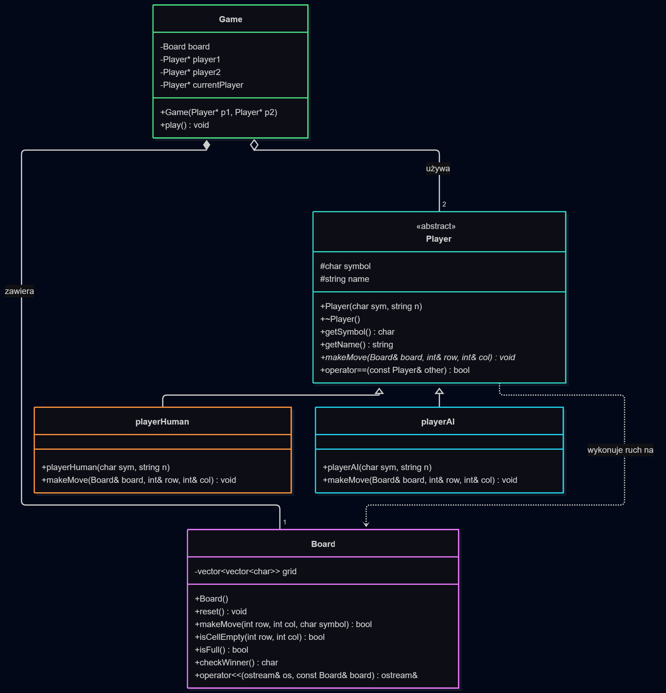

# Kółko i Krzyżyk (C++)

Konsolowa gra **Kółko i Krzyżyk** napisana obiektowo w języku C++ (standard C++17). Projekt obsługuje rozgrywkę dla dwóch graczy oraz grę przeciwko komputerowi, wykorzystując dziedziczenie, polimorfizm, przeciążanie operatorów oraz obsługę wyjątków.

## Funkcjonalności

* **Dwa tryby gry:**
  * *Gracz vs Gracz* (lokalna rozgrywka dla dwóch osób),
  * *Gracz vs Komputer* (przeciwnik komputerowy losujący wolne pola na planszy).
* **Wybór symbolu:** Gracz 1 wybiera symbol (`X` lub `O`), a drugi uczestnik automatycznie otrzymuje przeciwny znak.
* **Walidacja danych i obsługa wyjątków:** program zabezpiecza wejście przed błędnym formatem danych (np. wpisaniem liter zamiast liczb), współrzędnymi spoza zakresu planszy (`0–2`), próbą zajęcia zajętego pola oraz przerwaniem strumienia wejściowego (`EOF`).
* **Obsługa polskich znaków w konsoli Windows:** kodowanie `CP1250` ustawiane automatycznie na platformie Windows (`SetConsoleOutputCP(1250)` i `SetConsoleCP(1250)`).

## Architektura i schemat UML

* **Abstrakcja i polimorfizm:** abstrakcyjna klasa bazowa `Player` z czysto wirtualną metodą `makeMove(...)` i wirtualnym destruktorem oraz klasy pochodne `playerHuman` i `playerAI`.
* **Kompozycja i agregacja:** klasa `Game` zawiera obiekt `Board` (kompozycja) oraz zarządza wskaźnikami do dwóch obiektów `Player` (agregacja).
* **Przeciążanie operatorów:**
  * `operator<<` w klasie `Board` – sformatowane wyświetlanie planszy 3×3 w strumieniu wyjściowym,
  * `operator==` w klasie `Player` – porównywanie graczy na podstawie przypisanego symbolu.
* **Obsługa wyjątków (`<stdexcept>`):** klasy `invalid_argument`, `out_of_range`, `logic_error` oraz `runtime_error` rzucane przy błędnych ruchach i przechwytywane w głównej pętli `Game::play()`.



### Opis klas

| Klasa | Pliki | Odpowiedzialność |
| :--- | :--- | :--- |
| `Board` | `board.h`, `board.cpp` | Przechowuje planszę 3×3 (`vector<vector<char>>`), resetuje stan gry, sprawdza dostępność pól, wykonuje ruchy, weryfikuje zwycięzcę/remis i formatuje wydruk planszy (`operator<<`). |
| `Player` | `player.h`, `player.cpp` | Abstrakcyjna klasa bazowa przechowująca symbol i nazwę gracza; definiuje interfejs `makeMove` oraz `operator==`. |
| `playerHuman` | `player.h`, `player.cpp` | Pobiera współrzędne ruchu od użytkownika ze standardowego wejścia i waliduje poprawność danych za pomocą wyjątków. |
| `playerAI` | `player.h`, `player.cpp` | Implementacja prostego gracza komputerowego wybierającego losowo wolne pole (`rand() % 3`). |
| `Game` | `game.h`, `game.cpp` | Zarządza przebiegiem rozgrywki, zmianą tur, przechwytywaniem wyjątków podczas ruchów oraz ogłaszaniem wyniku końcowego. |

## Struktura projektu

```text
.
├── main.cpp                          # Punkt wejścia, konfiguracja konsoli, menu wyboru trybu i symbolu
├── board.h / board.cpp               # Definicja i implementacja klasy Board
├── player.h / player.cpp             # Definicja i implementacja klas Player, playerHuman, playerAI
├── game.h / game.cpp                 # Definicja i implementacja klasy Game
├── schemat_UML_Kolko_Krzyzyk.png     # Diagram klas UML
└── Kolko_Krzyzyk_cpp_project.exe     # Skompilowany plik wykonywalny (Windows)
